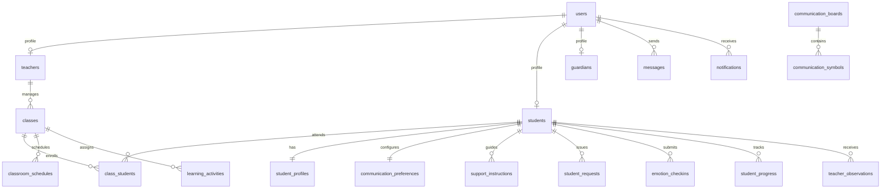

# AbleConnect: Complete Database Schema Specification

This document details the complete 19-table normalized schema for the AbleConnect platform, designed for SQLAlchemy ORM and compatible with both PostgreSQL and SQLite.

---

## 1. `users`
Core user identity and authentication credentials.
- `id` (INTEGER, Primary Key, Auto-increment)
- `email` (VARCHAR(255), Unique, Not Null, Indexed)
- `hashed_password` (VARCHAR(255), Not Null)
- `full_name` (VARCHAR(150), Not Null)
- `role` (VARCHAR(20), Not Null) - `teacher`, `student`, `guardian`, `admin`
- `avatar_url` (VARCHAR(500), Nullable)
- `is_active` (BOOLEAN, Default True)
- `created_at` (DATETIME, Default Now)
- `updated_at` (DATETIME, Default Now)

## 2. `teachers`
Teacher-specific professional metadata.
- `id` (INTEGER, Primary Key, Auto-increment)
- `user_id` (INTEGER, Foreign Key -> `users.id`, Unique, Not Null)
- `title` (VARCHAR(50)) - e.g., "Special Ed Teacher", "Grade 3 Lead"
- `school_name` (VARCHAR(150), Not Null)
- `department` (VARCHAR(100), Nullable)
- `room_number` (VARCHAR(30), Nullable)
- `created_at` (DATETIME, Default Now)

## 3. `students`
Student profile records.
- `id` (INTEGER, Primary Key, Auto-increment)
- `user_id` (INTEGER, Foreign Key -> `users.id`, Unique, Not Null)
- `student_code` (VARCHAR(50), Unique, Not Null)
- `date_of_birth` (DATE, Nullable)
- `emergency_contact` (VARCHAR(100), Nullable)
- `bio` (TEXT, Nullable)
- `avatar_color` (VARCHAR(30), Default "blue")
- `interface_mode` (VARCHAR(30), Default "visual_aac") - e.g. `visual_aac`, `simplified_text`, `audio_assisted`
- `created_at` (DATETIME, Default Now)

## 4. `guardians`
Guardian contact and authorization details.
- `id` (INTEGER, Primary Key, Auto-increment)
- `user_id` (INTEGER, Foreign Key -> `users.id`, Unique, Not Null)
- `phone_number` (VARCHAR(50), Nullable)
- `relationship_to_student` (VARCHAR(50), Not Null) - e.g. "Parent", "Foster Guardian"
- `preferred_contact_method` (VARCHAR(30), Default "email")
- `created_at` (DATETIME, Default Now)

## 5. `classes`
Classroom groupings created and managed by teachers.
- `id` (INTEGER, Primary Key, Auto-increment)
- `teacher_id` (INTEGER, Foreign Key -> `teachers.id`, Not Null)
- `name` (VARCHAR(150), Not Null)
- `grade_level` (VARCHAR(50), Not Null)
- `section` (VARCHAR(50), Nullable)
- `room` (VARCHAR(50), Nullable)
- `schedule_summary` (VARCHAR(255), Nullable)
- `color_theme` (VARCHAR(30), Default "teal")
- `is_active` (BOOLEAN, Default True)
- `created_at` (DATETIME, Default Now)

## 6. `class_students`
Many-to-many relationship linking students to classes.
- `id` (INTEGER, Primary Key, Auto-increment)
- `class_id` (INTEGER, Foreign Key -> `classes.id`, Not Null)
- `student_id` (INTEGER, Foreign Key -> `students.id`, Not Null)
- `joined_at` (DATETIME, Default Now)
- `status` (VARCHAR(20), Default "active")

## 7. `student_profiles`
Detailed individual support and sensory profiles.
- `id` (INTEGER, Primary Key, Auto-increment)
- `student_id` (INTEGER, Foreign Key -> `students.id`, Unique, Not Null)
- `preferred_name` (VARCHAR(100), Nullable)
- `sensory_profile` (TEXT, Nullable) - e.g. "Prefers low ambient noise; fluorescent lights can induce fatigue"
- `assistance_level` (VARCHAR(50), Default "moderate") - "independent", "minimal", "moderate", "intensive"
- `alert_preferences` (VARCHAR(100), Default "gentle_visual")
- `emergency_notes` (TEXT, Nullable)
- `updated_by_user_id` (INTEGER, Foreign Key -> `users.id`, Nullable)
- `updated_at` (DATETIME, Default Now)

## 8. `communication_preferences`
Detailed communication modalities and accessibility preferences.
- `id` (INTEGER, Primary Key, Auto-increment)
- `student_id` (INTEGER, Foreign Key -> `students.id`, Unique, Not Null)
- `verbal_communication` (BOOLEAN, Default True)
- `written_communication` (BOOLEAN, Default True)
- `picture_based_communication` (BOOLEAN, Default True)
- `text_to_speech` (BOOLEAN, Default True)
- `sign_language` (BOOLEAN, Default False)
- `gestures` (BOOLEAN, Default False)
- `custom_methods` (TEXT, Nullable)
- `preferred_symbol_size` (VARCHAR(20), Default "large") - `standard`, `large`, `extra_large`
- `speech_rate` (FLOAT, Default 1.0)
- `high_contrast_mode` (BOOLEAN, Default False)
- `updated_at` (DATETIME, Default Now)

## 9. `support_instructions`
Specific, teacher-approved communication strategies.
- `id` (INTEGER, Primary Key, Auto-increment)
- `student_id` (INTEGER, Foreign Key -> `students.id`, Not Null)
- `category` (VARCHAR(50), Not Null) - `communication`, `sensory`, `learning`, `interaction`
- `instruction` (TEXT, Not Null) - e.g. "Allow 5-10 seconds of processing time before prompting again"
- `priority` (VARCHAR(20), Default "normal") - `low`, `normal`, `high`, `essential`
- `approved_by_user_id` (INTEGER, Foreign Key -> `users.id`, Nullable)
- `approved_at` (DATETIME, Nullable)
- `is_active` (BOOLEAN, Default True)
- `created_at` (DATETIME, Default Now)

## 10. `messages`
Private, accessible two-way messages between users (teacher-student, teacher-guardian).
- `id` (INTEGER, Primary Key, Auto-increment)
- `sender_id` (INTEGER, Foreign Key -> `users.id`, Not Null)
- `recipient_id` (INTEGER, Foreign Key -> `users.id`, Not Null)
- `class_id` (INTEGER, Foreign Key -> `classes.id`, Nullable)
- `content` (TEXT, Not Null)
- `message_type` (VARCHAR(30), Default "text") - `text`, `picture_sequence`, `audio_phrase`, `quick_preset`
- `attachments` (TEXT, Nullable) - JSON encoded symbol or resource identifiers
- `is_read` (BOOLEAN, Default False)
- `read_at` (DATETIME, Nullable)
- `created_at` (DATETIME, Default Now)

## 11. `communication_boards`
AAC visual grid collections tailored for students or classes.
- `id` (INTEGER, Primary Key, Auto-increment)
- `student_id` (INTEGER, Foreign Key -> `students.id`, Nullable)
- `teacher_id` (INTEGER, Foreign Key -> `teachers.id`, Nullable)
- `title` (VARCHAR(150), Not Null)
- `description` (TEXT, Nullable)
- `category` (VARCHAR(50), Default "general") - `needs`, `emotions`, `classroom`, `activities`
- `grid_columns` (INTEGER, Default 4)
- `is_default` (BOOLEAN, Default False)
- `is_public` (BOOLEAN, Default False)
- `created_at` (DATETIME, Default Now)

## 12. `communication_symbols`
Individual visual AAC cards that make up communication boards.
- `id` (INTEGER, Primary Key, Auto-increment)
- `board_id` (INTEGER, Foreign Key -> `communication_boards.id`, Not Null)
- `label` (VARCHAR(100), Not Null)
- `icon_name` (VARCHAR(100), Not Null) - Lucide icon name or image path
- `speech_text` (VARCHAR(255), Not Null) - Spoken phrase when clicked or sequenced
- `category` (VARCHAR(50), Not Null) - `pronoun`, `verb`, `noun`, `need`, `emotion`, `social`
- `position_order` (INTEGER, Default 0)
- `bg_color` (VARCHAR(30), Default "bg-blue-50")
- `border_color` (VARCHAR(30), Default "border-blue-200")

## 13. `student_requests`
Fast, non-stigmatizing student assistance requests.
- `id` (INTEGER, Primary Key, Auto-increment)
- `student_id` (INTEGER, Foreign Key -> `students.id`, Not Null)
- `teacher_id` (INTEGER, Foreign Key -> `teachers.id`, Nullable)
- `class_id` (INTEGER, Foreign Key -> `classes.id`, Nullable)
- `request_type` (VARCHAR(50), Not Null) - `help`, `break`, `dont_understand`, `washroom`, `uncomfortable`
- `message` (TEXT, Nullable)
- `status` (VARCHAR(30), Default "sent") - `sent`, `seen`, `responded`, `resolved`
- `response_notes` (TEXT, Nullable)
- `created_at` (DATETIME, Default Now)
- `responded_at` (DATETIME, Nullable)

## 14. `emotion_checkins`
Daily visual student emotional state check-in.
- `id` (INTEGER, Primary Key, Auto-increment)
- `student_id` (INTEGER, Foreign Key -> `students.id`, Not Null)
- `class_id` (INTEGER, Foreign Key -> `classes.id`, Nullable)
- `emotion` (VARCHAR(50), Not Null) - `happy`, `calm`, `tired`, `confused`, `sad`, `anxious`, `frustrated`
- `notes` (TEXT, Nullable)
- `energy_level` (INTEGER, Default 3) - 1 (low) to 5 (high)
- `created_at` (DATETIME, Default Now)

## 15. `classroom_schedules`
Visual timetable entries with accessible icons.
- `id` (INTEGER, Primary Key, Auto-increment)
- `class_id` (INTEGER, Foreign Key -> `classes.id`, Not Null)
- `student_id` (INTEGER, Foreign Key -> `students.id`, Nullable) - Null if class-wide
- `day_of_week` (VARCHAR(20), Not Null) - `Monday`, `Tuesday`, etc.
- `period_name` (VARCHAR(100), Not Null)
- `subject` (VARCHAR(100), Not Null)
- `start_time` (VARCHAR(10), Not Null) - e.g. "09:00"
- `end_time` (VARCHAR(10), Not Null) - e.g. "09:45"
- `visual_icon` (VARCHAR(50), Default "book")
- `room` (VARCHAR(50), Nullable)
- `instructions` (TEXT, Nullable)
- `is_current` (BOOLEAN, Default False)

## 16. `learning_activities`
Classroom assignments and activities with simplified steps.
- `id` (INTEGER, Primary Key, Auto-increment)
- `class_id` (INTEGER, Foreign Key -> `classes.id`, Not Null)
- `teacher_id` (INTEGER, Foreign Key -> `teachers.id`, Not Null)
- `title` (VARCHAR(200), Not Null)
- `description` (TEXT, Not Null)
- `simplified_steps` (TEXT, Nullable) - JSON encoded array of concise steps
- `subject` (VARCHAR(100), Not Null)
- `target_skills` (VARCHAR(255), Nullable)
- `due_date` (DATETIME, Nullable)
- `created_at` (DATETIME, Default Now)

## 17. `student_progress`
Individualized, non-comparative milestone and goal tracking.
- `id` (INTEGER, Primary Key, Auto-increment)
- `student_id` (INTEGER, Foreign Key -> `students.id`, Not Null)
- `activity_id` (INTEGER, Foreign Key -> `learning_activities.id`, Nullable)
- `goal_description` (TEXT, Not Null) - e.g. "Communicates needs using 2-card AAC sequence"
- `baseline` (VARCHAR(100), Nullable)
- `current_status` (VARCHAR(50), Default "in_progress") - `not_started`, `emerging`, `in_progress`, `achieved`
- `progress_percentage` (INTEGER, Default 0)
- `notes` (TEXT, Nullable)
- `recorded_by_user_id` (INTEGER, Foreign Key -> `users.id`, Not Null)
- `created_at` (DATETIME, Default Now)

## 18. `teacher_observations`
Confidential, access-controlled educator observational notes.
- `id` (INTEGER, Primary Key, Auto-increment)
- `student_id` (INTEGER, Foreign Key -> `students.id`, Not Null)
- `teacher_id` (INTEGER, Foreign Key -> `teachers.id`, Not Null)
- `observation_date` (DATETIME, Default Now)
- `category` (VARCHAR(50), Not Null) - `learning`, `communication`, `participation`, `challenge`, `effective_strategy`
- `content` (TEXT, Not Null)
- `is_private` (BOOLEAN, Default True)
- `created_at` (DATETIME, Default Now)

## 19. `notifications`
In-app accessibility alerts and updates.
- `id` (INTEGER, Primary Key, Auto-increment)
- `user_id` (INTEGER, Foreign Key -> `users.id`, Not Null)
- `title` (VARCHAR(150), Not Null)
- `content` (TEXT, Not Null)
- `notification_type` (VARCHAR(50), Default "system") - `help_request`, `message`, `schedule`, `system`
- `is_read` (BOOLEAN, Default False)
- `link_url` (VARCHAR(255), Nullable)
- `created_at` (DATETIME, Default Now)
