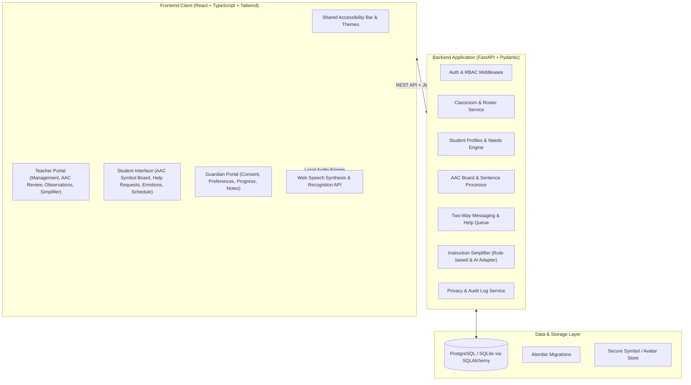

# AbleConnect: Project Architecture & Technical Design

## 1. System Vision & Architecture Overview

AbleConnect is built as a modular client-server web application adhering to accessibility, privacy, and educational data protection guidelines.



---

## 2. Component Design Principles

### A. Separation of Interface Modes
- **Teacher View:** Information-dense, data-organized, accessible SaaS dashboard with multi-pane navigation, table/card rosters, communication feeds, and pedagogical notes.
- **Student View:** Ultra-low cognitive load, large tactile tap-targets (minimum 48x48px, target 64-96px for AAC cards), high visual affordance, icon-first hierarchy, zero cluttered sidebars, simplified single-click back navigation, and speech synthesis feedback.
- **Guardian View:** Focused on authorized child progress, communication preference calibration, teacher communication, and transparent care instructions.

### B. Two-Way Accessible Communication Loop
1. **Student initiates** via visual AAC card sequence (e.g. `[I Need]` + `[Break]`) or the **One-Tap Help Button** (`[I Need Help]`).
2. **Audio Feedback**: The student hears spoken sentence verification locally via the Web Speech API.
3. **Teacher Real-Time Queue**: Teacher dashboard immediately surfaces incoming requests with status badges (`Sent` -> `Seen` -> `Responded`).
4. **Teacher Response**: Teacher responds with tailored text or picture cues, updating the student's status indicator.

### C. Instruction Simplifier Architecture
- Supports teachers translating standard classroom instructions into digestible steps.
- **Dual Pipeline**:
  - **Rule-based fallback**: Deterministic sentence splitter, keyword extractor, imperative verb ordering, bullet formatting, and reading level adjustment without requiring internet/API keys.
  - **AI Provider Adapter**: Pluggable backend adapter (Gemini API / external LLM) when configured, preserving the privacy constraint: *No student identifying information or disability diagnosis is ever transmitted to external AI endpoints*.
- Teachers **must review and approve** simplified instructions before publishing to student timetables or assignments.

---

## 3. Technology Stack Justification

| Layer | Selected Tech | Justification |
| :--- | :--- | :--- |
| **Frontend Framework** | React 18 + TypeScript | Component reusability, strict typing for complex accessibility models, predictable state flow. |
| **Build Tool** | Vite | Instant HMR, lightweight bundle size, modern ES module bundling. |
| **Styling** | Tailwind CSS | Utility-first CSS enables rapid implementation of custom contrast themes, dynamic rem font sizing, and accessible focus outlines. |
| **Icons** | Lucide React | High-contrast, clean SVGs with semantic labels and customizable stroke widths. |
| **Backend Framework** | Python FastAPI | High-performance asynchronous REST endpoints, automatic OpenAPI documentation, Pydantic type safety. |
| **ORM & Database** | SQLAlchemy 2.0 + SQLite / PostgreSQL | Multi-dialect support, declarative mappings for all 19 entities, transaction safety, and migration support via Alembic. |
| **Speech Engine** | Browser Web Speech API | Client-side, zero latency, privacy-respecting (no audio recording uploaded to third-party servers for synthesis). |

---

## 4. Layered Directory Layout

```
ableconnect/
├── backend/
│   ├── app/
│   │   ├── api/
│   │   │   ├── auth.py
│   │   │   ├── classes.py
│   │   │   ├── students.py
│   │   │   ├── communication.py
│   │   │   ├── tools.py
│   │   │   └── guardian.py
│   │   ├── core/
│   │   │   ├── config.py
│   │   │   ├── security.py
│   │   │   └── database.py
│   │   ├── models/
│   │   │   └── __init__.py (All 19 SQLAlchemy models)
│   │   ├── schemas/
│   │   │   └── __init__.py (Pydantic request/response schemas)
│   │   ├── services/
│   │   │   ├── simplifier.py
│   │   │   └── aac_service.py
│   │   └── seed.py
│   ├── requirements.txt
│   └── main.py
├── frontend/
│   ├── src/
│   │   ├── components/
│   │   │   ├── common/
│   │   │   ├── teacher/
│   │   │   ├── student/
│   │   │   └── guardian/
│   │   ├── context/
│   │   │   ├── AuthContext.tsx
│   │   │   └── AccessibilityContext.tsx
│   │   ├── pages/
│   │   │   ├── LandingPage.tsx
│   │   │   ├── TeacherDashboard.tsx
│   │   │   ├── StudentDashboard.tsx
│   │   │   ├── GuardianPortal.tsx
│   │   │   └── LoginModal.tsx
│   │   ├── services/
│   │   │   ├── api.ts
│   │   │   └── speech.ts
│   │   ├── types/
│   │   │   └── index.ts
│   │   ├── App.tsx
│   │   ├── index.css
│   │   └── main.tsx
```
